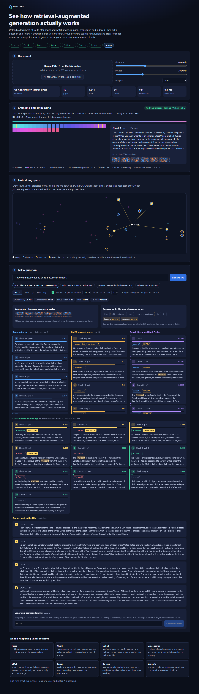
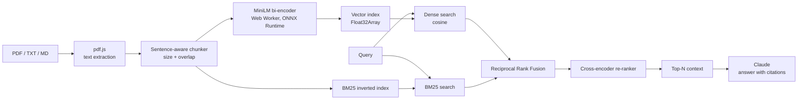

# RAG Lens

**See how retrieval-augmented generation actually works.** Upload a document of up to 500 pages and watch every stage of a RAG pipeline run live: chunking, embedding, dense vector search, BM25 keyword search, rank fusion, cross-encoder re-ranking, and grounded answer generation.

The whole pipeline runs in the browser. There is no backend, the document never leaves the tab, and the retrieval demo needs no API key.

**Live demo:** _add your link here after deploying_



## What you can see

| Stage | What is visualised |
| --- | --- |
| Parse | Page-by-page text extraction from PDF, TXT or Markdown (500-page cap) |
| Chunk | One tile per chunk; click a tile to read it, with the overlap from the previous chunk highlighted |
| Embed | Tiles light up as each chunk becomes a 384-dimensional vector, shown as a heat strip, with live throughput |
| Embedding space | PCA projection of all chunk vectors; the query and its hits are plotted in the same space |
| Query analysis | The query as a vector (dense path) and as weighted terms with IDF values (keyword path) |
| Retrieve | Dense (cosine) and BM25 results side by side, with per-term BM25 score contributions |
| Fuse | Reciprocal Rank Fusion, showing where each candidate ranked in each retriever |
| Re-rank | Cross-encoder scores arriving live, and how far each chunk moved up or down |
| Generate | The exact context sent to the LLM, and an optional streamed answer with citations |

Hovering a chunk anywhere highlights the same chunk in every other view. Retrieval mode (hybrid, dense only, BM25 only), re-ranking, top-K and context size can be switched to compare results.

## Architecture



- **Embeddings:** `all-MiniLM-L6-v2` through Transformers.js (ONNX Runtime Web), in a Web Worker so the UI keeps animating. Uses WebGPU for large documents when available, multi-threaded WebAssembly otherwise.
- **BM25:** implemented from scratch in [src/lib/bm25.ts](src/lib/bm25.ts) (inverted index, IDF, length normalisation).
- **Vector search, RRF and PCA:** implemented from scratch in [src/lib/vector.ts](src/lib/vector.ts).
- **Re-ranking:** `ms-marco-MiniLM-L-6-v2` cross-encoder, also in the worker.
- **Generation:** optional. The visitor pastes their own Anthropic API key, which is sent only from their browser to the Anthropic API and kept in `sessionStorage` for the tab's lifetime.

## Tech stack

React 19, TypeScript, Vite, Transformers.js, ONNX Runtime Web (WebGPU / WASM), pdf.js, Canvas 2D, Anthropic SDK.

## Run locally

```bash
npm install
npm run dev        # http://localhost:5173
npm run build      # type-check + production build into dist/
npm run preview    # serve the production build
```

Requires Node 20 or newer. The two models (about 23 MB each) are downloaded from the Hugging Face hub on first use and cached by the browser.

## Deploy

The app is a static site. On Vercel: import the GitHub repository and accept the detected Vite settings. [vercel.json](vercel.json) sets the cross-origin isolation headers that enable multi-threaded WebAssembly. Without those headers (for example on GitHub Pages) the app still works, with slower CPU embedding.

## Performance

Measured on a laptop with a 4-core CPU and Intel integrated graphics:

| Document | Chunks | Parse + chunk | Embed |
| --- | --- | --- | --- |
| Sample (12 pages) | 36 | under 1 s | about 6 s |
| 500-page PDF (191k words) | 1,515 | about 3 s | about 2.5 to 3 min |

Query latency after the models are warm: about 70 ms to embed the query, about 10 ms for dense plus BM25 search over 1,515 chunks, and about 1.4 s to re-rank 10 candidates.

## Limitations

- Scanned PDFs need OCR first; only selectable text is extracted.
- The index lives in memory, so it is rebuilt when the page reloads.
- Dense search is exact brute force, which is fast at this scale; a larger corpus would need an ANN index such as HNSW.
- The BM25 tokeniser is tuned for English.

## Credits

The sample document is the United States Constitution (public domain), text via Project Gutenberg.
